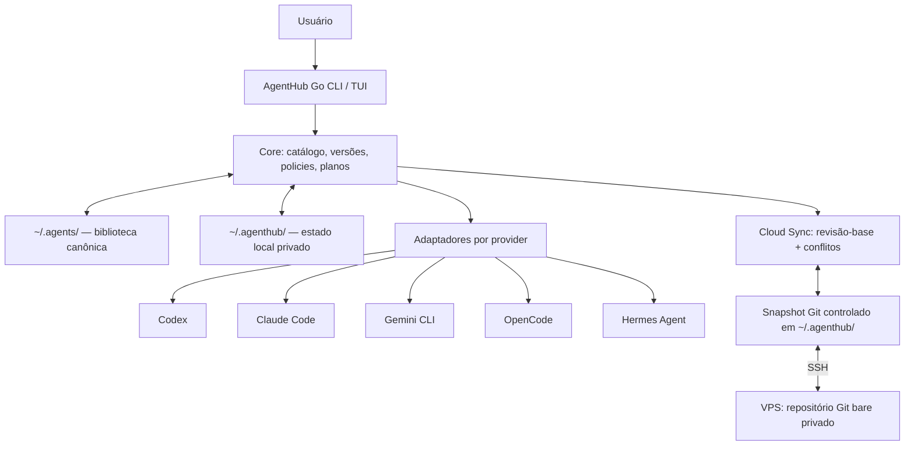

# AgentHub — Arquitetura de Software

> **Versão:** 0.1.0 · **Data:** 2026-10-24  
> **Status:** arquitetura-alvo CLI-first; não inferir implementação existente  
> **Complementares:** [PRD.md](./PRD.md) · [AGENTS.md](./AGENTS.md)

## 1. Resumo arquitetural

O AgentHub é um **aplicativo Go modular e offline-first**, com uma **biblioteca canônica compartilhada em `~/.agents/`**, um **estado interno separado em `~/.agenthub/`**, adaptadores para ferramentas de IA e uma réplica privada via **Git/SSH em uma VPS**. Sua experiência principal é uma CLI (`agenthub`), com TUI opcional na F3.

As três fronteiras não devem ser confundidas:



**`import`** copia/adota conteúdo existente para a biblioteca, após aprovação. **`apply`** materializa conteúdo da biblioteca nos destinos suportados, após plano. **`cloud sync`** replica a biblioteca autorizada, **não** aplica automaticamente nos providers.

## 2. Decisões (ADRs baseline)

| ADR | Decisão | Justificativa / ressalva |
|---|---|---|
| ADR-001 | Go como única linguagem do núcleo/CLI | Binários nativos, I/O, processos Git/SSH, distribuição simplificada |
| ADR-002 | Cobra para CLI; Bubble Tea/Lip Gloss apenas na F3 | Comandos scriptáveis primeiro, TUI como adaptador de apresentação |
| ADR-003 | `~/.agents/` como canônico | Interoperabilidade e compatibilidade com a convenção do AgentLoom |
| ADR-004 | `~/.agenthub/` para estado, snapshots e configurações privadas | Separar conteúdo portável de dados de operação por máquina |
| ADR-005 | `.agents` é compartilhada, não proprietária | Proteção de arquivos de outros gerenciadores; ownership explícita |
| ADR-006 | Recursos com UUID + revisões imutáveis + hash SHA-256 | Identidade independente do nome/path e comparações confiáveis |
| ADR-007 | Adapters com matriz de capabilities por versão/escopo | Não prometer suporte de formatos não testados |
| ADR-008 | Apply transacional baseado em plan/snapshot/hash | Evitar overwrite/exclusão de recursos alheios |
| ADR-009 | VPS F2: Git bare privado sobre SSH | Infraestrutura pequena e histórico sem backend obrigatório |
| ADR-010 | Repositório Git de staging isolado da `~/.agents` | Um `git checkout/pull` não pode sobrescrever arquivos compartilhados |
| ADR-011 | Nunca sincronizar valores de segredos | SSH protege transporte, mas o Git remoto não cifra o conteúdo em repouso |
| ADR-012 | API/dashboard/vault E2E são extensões futuras | Preservar domínio exportável; não introduzir dependência de servidor agora |

**Atenção ao legado:** estas decisões substituem intencionalmente escolhas do Harness Library anterior (Rust, monorepo web/API e `~/.harness`) por instrução atual do projeto. Não traduzir Rust e TS linha a linha para Go; preservar invariantes funcionais.

## 3. Escopo do processo e organização Go

Sugestão de estrutura **modular, não obrigatória para um repositório já existente**:

```text
agenthub/
├── main.go
├── cmd/
│   ├── root.go
│   ├── init.go
│   ├── scan.go
│   ├── library.go
│   ├── apply.go
│   ├── cloud.go
│   ├── profile.go
│   ├── doctor.go
│   └── ui.go                 # apenas quando F3 começar
├── internal/
│   ├── domain/               # Resource, Revision, Scope, Deployment, Conflict
│   ├── library/              # operações sobre conteúdo canônico
│   ├── discovery/            # detect/scan read-only
│   ├── providers/            # registry + adapters por provider
│   │   ├── codex/
│   │   ├── claude/
│   │   └── opencode/
│   ├── planner/              # planos/validação de pré-condições
│   ├── deployment/           # apply/rollback/ownership
│   ├── storage/              # índices/estado operacional, transações
│   ├── cloud/                # Git staging + sync + conflitos
│   ├── profiles/             # seleção/escopos
│   ├── security/             # path validation, redaction, policies
│   └── tui/                  # Bubble Tea; depende dos casos de uso
├── testdata/                 # fixtures e diretórios descartáveis
├── docs/
├── PRD.md
├── ARCHITECTURE.md
├── AGENTS.md
├── go.mod
└── go.sum
```

Regras de fronteira:

- `cmd/` e `tui/`: parseiam entrada e exibem saída; não contêm lógica de negócio.
- `domain/` não conhece Cobra, Bubble Tea, SSH ou caminhos específicos de ferramentas.
- `providers/`: detectam, validam e traduzem; não controlam política global de overwrite ou sincronização remota.
- `cloud/`: não sabe interpretar Markdown/formatos nativos específicos de Codex/Claude.
- `deployment/`: escreve somente destinos aprovados e rastreados; registra sucesso/falha por destino.
- `storage/`: nunca é a única cópia de um recurso; `.agents` sempre contém o conteúdo legível/exportável.
- Dependências devem fluir de UI/infraestrutura para interfaces pequenas do domínio, nunca o contrário.

## 4. Layout de arquivos e ownership

### 4.1. Home canônico

```text
~/
├── .agents/                         # conteudos portáveis; outros apps podem escrever aqui
│   ├── agents/                       # agentes declarativos
│   ├── skills/
│   │   └── react-architecture/
│   │       ├── SKILL.md
│   │       ├── references/
│   │       └── scripts/
│   ├── prompts/
│   ├── commands/
│   ├── rules/
│   ├── memory/
│   ├── mcps/                        # manifests extras opcionais
│   ├── mcp.json                     # servers declarativos sem segredos
│   ├── plugins/
│   ├── knowledge/
│   ├── profiles/
│   └── .agenthub/                   # metadados portáveis SOB namespace reservado
│       ├── registry.json            # recurso ID, origem, tipo, escopo, revisão
│       └── format-version.json
│
└── .agenthub/                       # exclusivo do aplicativo e do dispositivo
    ├── config.yaml                  # sem secrets
    ├── state/                       # deployment, hashes, base e fila durável
    ├── git/                         # Git + snapshot replicável DERIVADO
    ├── backups/
    ├── trash-local/                 # restauração operacional local
    ├── cache/
    ├── conflicts/
    └── logs/
```

`~` = diretório home real do usuário, resolvido por Go (`os.UserHomeDir`, caminhos via `filepath`), inclusive Windows. Nunca criar a pasta `.agents` do usuário pela primeira vez sem comando explícito (`init`). O `init` não pode tomar posse nem reformatar arquivos preexistentes.

**Compatibilidade AgentLoom:** preservar `~/.agents/agents.lock.json`, `settings.local.json`, `.sync-manifest.json` e quaisquer outros arquivos externos. O AgentHub não os reinterpreta como sua própria propriedade. Não substituir esses arquivos por versões próprias.

**Registry:** a especificação usa `~/.agents/.agenthub/registry.json` para metadados portáveis de *recursos adotados/gerenciados*. Esse namespace deve ser verificado contra leitores de terceiros durante F0; caso incompatível, registrar ADR e escolher um sidecar equivalente sem mudar o conteúdo das skills existentes. `~/.agents/.agenthub` jamais contém segredos ou caminhos absolutos do dispositivo.

**Não colocar `.git` diretamente em `~/.agents`:** a integração Git usa staging isolado em `.agenthub/git/`, mesmo que isso crie uma cópia operacional transitória. Ela não é outra fonte canônica; conflitos são sempre reconciliados de volta à árvore `~/.agents` sob aprovação.

### 4.2. Recursos por projeto

```text
<projeto>/.agents/                  # canônico do projeto, não varrer sem permissão
<projeto>/.agents/.agenthub/        # metadados de projeto (quando opt-in)
```

- `projectId` é estável mesmo após mover/renomear o repositório.
- Escopos de projeto dependem de inscrição explícita; só são sincronizados se configurados. Nunca exportar caminhos absolutos.
- Prioridade de seleção interna: projeto > global para mesma classe/slug; a precedência real do provider deve ser verificada antes do apply.
- Não escrever metadados dentro de projetos sem permissão do usuário; pode haver mapeamento local temporário em `~/.agenthub/state`.

### 4.3. Ownership de deployments

Um `Deployment` registra `deploymentId`, `resourceId`, `resourceRevisionId`, `providerId`, `scope`, `targetPath` **local**, `strategy` (native/shared/copy/link/transform), `installedHash`, `previousSnapshotId`, `adapterVersion`, `status` e timestamps.

**Condições para write/removal:** destino explicitamente autorizado + plano íntegro/não expirado + hash atual igual ao observado + ownership conhecida ou aprovação explícita de adoção. Para diretórios compartilhados, modificar apenas seções/chaves gerenciadas quando possível. Dados não pertencentes ao AgentHub são intocáveis.

## 5. Modelo de domínio (contratos)

### 5.1. Entidades

| Entidade | Campos mínimos e invariantes |
|---|---|
| `Resource` | ID imutável, kind, slug, título, escopo, source, trustPolicy, status |
| `ResourceRevision` | ID, resourceId, baseRevisionId, contentHash, manifest, authorOrigin, createdAt; **imutável** |
| `ResourceBundle` | Arquivos relativos, entrada principal, metadados; hash reprodutível; sem traversal |
| `ImportCandidate` | sourcePath, provider, kind, fingerprints, riscos, destino proposto; não é Resource automaticamente |
| `SourceLock` | origem (Git/path), ref solicitado, commit resolvido, conteúdo importado, renomeações |
| `Deployment` | posse de destino + hash + snapshot anterior + status |
| `Operation` | ID/idempotencyKey, target, baseHash/revision, status/erro; repetição idempotente |
| `Conflict` | resourceId, base, local, remote, reason, resolutionStatus; nunca last-write-wins |
| `Profile` | ID, escopo, seleção de tipos/recursos/providers, exclusões e overrides |
| `ProviderCapability` | provider, detectedVersion, kind, scope, supportLevel, evidence, strategy |
| `TrashEntry` | resourceId, tombstoneRevision, retentionUntil, restore state |

### 5.2. Exemplo de manifesto portátil

```yaml
schemaVersion: 1
resourceId: 52f1ce3d-66ca-4abf-b902-964a78bc37ac
kind: skill
slug: react-architecture
title: React Architecture
scope:
  type: global
entrypoint: skills/react-architecture/SKILL.md
source:
  type: git
  url: https://github.com/example/skills
  commit: 9c8a0c5  # Exemplo ilustrativo; revisão real deve ser resolvida
contentHash: sha256:<digest-calculado>
status: active
```

O manifesto acima é **representação lógica**, não exigência de um arquivo `resource.yaml` dentro de cada skill. Os metadados podem ficar agregados no registry sidecar para preservar compatibilidade de terceiros. O hash real é computado a partir de uma lista estável de paths relativos + bytes, rejeitando arquivos fora da raiz e metadados variáveis do sistema.

### 5.3. Estado local

Persistir localmente: device ID, roots consentidas, revisão-base remota, fila/outbox, hash de deployments, planos aprovados, snapshots, cursores e último resultado de sync. SQLite local (driver Go sem CGO, se tecnicamente adequado) é preferível para fila transacional, mas uma implementação existente testada pode ser preservada. Conteúdo de recurso e perfis continuam em arquivos normais; estado é reconstruível em parte.

## 6. Interfaces Go de adaptação

Interfaces abaixo são **contratos ilustrativos**, a ajustar ao repositório real (não scaffolds obrigatórios):

```go
type ProviderAdapter interface {
    ID() string
    Detect(ctx context.Context, env Environment) (DetectionReport, error)
    Capabilities(ctx context.Context, detection DetectionReport) CapabilityMatrix
    Discover(ctx context.Context, scope Scope) ([]ExternalResource, error)
    PlanApply(ctx context.Context, resource ResourceBundle, scope Scope) (Plan, error)
    PlanRemove(ctx context.Context, deployment Deployment) (Plan, error)
}

// A aplicação efetiva é autorizada pelo Application Service,
// que valida precondições, snapshots e ownership antes de chamar
// os writers do adaptador. Adapter nenhum decide permissões globais.
```

A matriz de capacidades é granular por `kind`, versão, escopo e estratégia; não existe flag única `supports_all`. Exemplo de statuses: `supported`, `partial`, `unsupported`, `not-tested`, `permission-required`, `error`.

**Providers prioritários:** Codex, Claude Code e OpenCode, mantendo Hermes Agent e Gemini CLI explicitamente no backlog de primeira expansão. Ajustar prioridade conforme instalações realmente detectadas. O suporte de `.agents/skills` deve ser validado **em runtime** por provider/versão; não confundir diretório existente com recurso consumido. Pi, Cursor e Copilot são expansões opcionais.

### 6.1. Estratégias de publicação

1. Usar diretamente destino compartilhado `.agents` se o provider realmente consumir aquele conteúdo e escopo.
2. Caso contrário, adapter gera arquivo nativo, preferindo cópia gerenciada no Windows, com backing de manifesto/snapshot.
3. Symlink/junction somente após prova de permissões/compatibilidade e aprovação específica.
4. Para JSON/TOML, editar apenas chaves sob ownership, preservando chaves não gerenciadas, comentários quando formato/biblioteca suportar; caso contrário reportar limitação e exigir aprovação de transformação.
5. Instruções textuais (`AGENTS.md`, `CLAUDE.md`, `GEMINI.md`) recebem blocos delimitados que o AgentHub controla, ou arquivo auxiliar referenciado quando suportado. Não substituir o arquivo inteiro.
6. Nunca executar arquivos em `scripts/`, hooks de Git, plugin desconhecido ou servidor MCP para descobrir/instalar configurações.

## 7. Plan/apply com integridade

```text
Library Resource
  -> Resolve capabilities/targets
  -> Build Plan (paths, oldHashes, newHashes, diff, risk, expiration)
  -> User approves plan ID
  -> Revalidate observed hashes + ownership
  -> Snapshot original bytes/metadata
  -> Apply safely (atomic where possible)
  -> Verify deployed hashes
  -> Persist Deployment + audit event
```

- `plan` é read-only e inclui a lista completa de alterações; cada target recebe motivo e risco.
- `apply` rejeita plano expirado, conflito, path escape, destino alterado após planejamento, adapter `unsupported` ou permissão insuficiente.
- Uma falha parcial registra resultados individuais, tenta reversão segura e nunca marca sucesso total.
- Idempotência: `apply` repetido para mesma revisão, sem drift, produz `noop`.
- `remove` vira lixeira/tombstone na biblioteca e **não** remove a cópia nativa de terceiros sem aprovação separada.
- `rollback` valida hashes atuais e preserva modificações subsequentes antes de restaurar qualquer snapshot.

## 8. Cloud Sync F2 — Git/SSH sem servidor de aplicação

### 8.1. Topologia na VPS

```text
VPS (Linux)
/srv/agenthub/
  configs.git/          # git bare PRIVADO, SSH; conteúdo NÃO cifrado em repouso
```

O usuário de SSH deve ter permissões mínimas, preferivelmente dedicado e restrito ao repositório. Não expor porta Git HTTP, não adicionar Git hooks que executem código de fontes não confiáveis. Criar pasta/usuário somente mediante autorização no servidor real; fornecer scripts/documentação parametrizados e testes com repositório bare local.

### 8.2. Staging seguro

A árvore `~/.agents` é compartilhada com outros apps. Por isso **nunca** executar `git pull`, `git checkout`, `git clean` ou `git reset --hard` diretamente nela. O mecanismo F2 deve:

1. Exportar SOMENTE recursos/paths explicitamente gerenciados e sincronizáveis para um *snapshot Git* isolado em `~/.agenthub/git/worktree`.
2. Excluir arquivos alheios, caminhos absolutos, arquivos temporários, estado local, caches, secrets, grandes binários não permitidos, perfis puramente locais.
3. Fazer `fetch` remoto e comparar `baseCommit`, `localSnapshot` e `remoteHead`.
4. Usar merge determinístico apenas quando inequivocamente seguro; conflito -> registrar versões `base/local/remote` e bloquear aquele recurso.
5. Publicar via push normal com checagem de ancestry; **nunca force-push automático**.
6. Aplicar resultado reconciliado em `~/.agents` por operações planejadas, guardando snapshot, hashes, aprovação/política já autorizada e journal durável.
7. Registrar commit/revisão-base apenas após verificação local; após restart recuperar operações pendentes.

Esta cópia temporária de staging é **derivada da biblioteca**, não um segundo lugar para editar conteúdos. O usuário edita `~/.agents` e o AgentHub materializa/resolve a réplica. Estágios de Git devem ser reproduzíveis.

### 8.3. Matriz de sincronização de um recurso

| Base | Local | Remote | Ação |
|---|---|---|---|
| igual | igual | igual | No-op |
| igual | alterado | igual | Publicar com CAS sobre base/head |
| igual | igual | alterado | Baixar e planejar materialização |
| igual | mesmo hash | mesmo hash | Atualizar revisão-base sem duplicar |
| igual | alterado A | alterado B | Conflito (ou merge comprovadamente seguro) |

Não usar `mtime` nem último escritor vence. Conflitos podem ser resolvidos com `keep-local`, `keep-remote`, `keep-both` quando compatível, ou editor de diff; ação é auditada e cria nova revisão/snapshot. Qualquer operação de exclusão é transportada como tombstone, não como `rm` imediato em todos os dispositivos.

### 8.4. Offline e recuperação

- Estado/outbox persistidos antes de confirmar ao usuário; modo offline permite editar conteúdo local e preparar commits pendentes.
- Retentativa usa idempotencyKey, revisão-base e verificação pós-escrita.
- `cloud sync` em máquina recém-conectada deve detectar arquivos locais preexistentes/estranhos antes de importar material remoto.
- `cloud status` relata online/offline, pendências, último remote/base, conflito, último sucesso/erro.
- SSH configura autenticação; não armazenar chave privada em `.agents` nem copiar credenciais em config exportada.

### 8.5. Limite de confiança da nuvem

Git remoto permite ao servidor ler todo conteúdo enviado. Não enviar memory privada, documentos sensíveis, `.env`, tokens, credenciais nem MCP tokens; optar por política allowlist de conteúdo sincronizável, com pré-scan e bloqueio de padrões comuns de secrets (detecção heurística não substitui revisão humana). Um Vault E2E seguro será uma feature separada, não um atalho de criptografia caseira.

## 9. Perfis, memória, plugins e conhecimento

- **Perfis:** regras de seleção/ativação não destroem definições canônicas; profile específico de projeto se sobrepõe ao global no domínio; providers são filtrados por capability.
- **Memória:** recursos explícitos com consentimento/proveniência, estados `pending/approved/rejected`; nunca tentar recuperar memórias internas de serviços cloud por engenharia reversa. Default: não replicar memória sensível.
- **Plugins:** metadados/catalogação primeiro; importação não executa instaladores/scripts. Instalação futura requer análise de permissões, integridade, opt-in e isolamento/rollback.
- **Knowledge:** indexação textual/local como baseline; anexos grandes só com limites e policy de cloud; RAG posterior e desacoplado.
- **MCP:** definições por provider resolvem variáveis localmente; segredos nunca constam do manifesto remoto.

## 10. Segurança operacional

Modelo de ameaça: arquivo hostil dentro de repositório importado, path traversal/ZIP slip, symlink/junction para fora de raízes consentidas, execução de hooks, overwrite de arquivos de terceiros, vazamento de segredos no Git remoto, race entre `plan` e `apply`, conflito concorrente entre computadores, permissões indevidas na VPS.

Controles obrigatórios:

- Canonicalizar e validar roots; rejeitar `..`, paths absolutos no manifesto, escapes de symlink, nomes inválidos, colisões de case, links atravessando drive.
- Invocar Git/SSH com `exec.CommandContext` + argv literal; nunca concatenar shell/PowerShell/cmd.
- Desabilitar hooks de repositórios importados durante operações de descoberta/importação; não confiar na configuração Git de fontes terceirizadas para rodar comandos.
- Descartar ou limitar arquivos enormes, tipos inesperados, estruturas recursivas/loops de links e número de entradas.
- Guardar backups de conteúdo afetado; pós-verificação de integridade após `apply`/`sync`.
- Logs estruturados, com redaction de paths sensíveis quando apropriado, tokens, Authorization, valores de MCP secrets, conteúdo privado de memórias.
- Planejar e exigir consentimento para mutações destrutivas. `--yes` não contorna barreiras de segurança nem soluciona conflitos.
- Opt-in de publicação por destino e classificação de privacidade antes de sync.
- Sem telemetria externa por padrão.

## 11. Testes, CI e qualidade

**Gates por alteração:** `gofmt`, `go vet ./...`, `go test ./...`, `go build ./...`. `go test -race ./...` quando suportado. Cross-build Windows/Linux/macOS quando a árvore permitir (CGO e dependências devem ser documentadas).

Testes essenciais:

| Camada | Casos |
|---|---|
| Scan | Reads only; configs com espaços/Unicode; conteúdo hostil não executado |
| Domínio | UUID estável, revisões imutáveis, hashes determinísticos, escopos |
| Import | Origem Git/local, duplicatas, conflitos, scripts ignorados, manifestos inválidos |
| Apply | Plan hash mismatch, snapshots, rollback, arquivos não gerenciados, múltiplos targets |
| Filesystem | Windows junction, links, case-insensitive, path traversal, Unicode, read-only paths |
| Sync | Dois worktrees, conflito concorrente, retry offline, push race, reinício, tombstones |
| Providers | Fixtures por versão, formato nativo validado, round-trip quando possível |
| Secrets | Nenhum valor real em staging Git, logs ou lockfiles; casos positivos/negativos |
| TUI | Confirmações e reuso do core; estados vazio/erro/offline/conflito |

**Definição de suporte real:** testar a descoberta do arquivo na CLI alvo, não apenas comprovar que o arquivo foi criado.

## 12. Evolução futura sem compromisso prematuro

API HTTP versionada, dashboard React, autenticação por dispositivo, execução automática de watcher, vault E2E, políticas centralizadas e catálogo remoto podem ser adicionados como componentes opcionais. O Core Go mantém entidades/versionamento portáveis; o protocolo Git/SSH da F2 deve estar atrás de uma interface de transporte/repositório remoto para permitir outro backend sem reescrever biblioteca ou adaptadores.

Se futuramente existir vault: cifras auditadas com chaves somente em dispositivo autorizado, recovery offline e pareamento explícito; nunca expor plaintext em dashboard servido pela VPS sem modelo de segurança compatível.

## 13. Migração de código já existente

A existência da F0 ou de F1/F2/F3 anteriores no repositório **não é presumida**. O Codex deve primeiro auditar árvore, `go.mod`, comandos, testes, docs e mudanças Git pendentes; mapear implementações à nova baseline. Implementar migrações aditivas/versionadas, sem `git clean`, `reset --hard`, alteração silenciosa do HOME real ou cópia em massa para `~/.agents`. Sempre criar snapshots e testes de compatibilidade antes de ativar escrita ou cloud sync.

**Decisão de transição se conteúdo anterior estiver em `~/.agenthub/library`:** fazer um `agenthub migrate --dry-run` que enumere arquivos, IDs, hashes e colisões; somente migrar para `~/.agents` após consentimento e backup; manter original intacto até a confirmação. Não presumir que uma biblioteca antiga está presente.

## 14. Fontes de referência

- Base funcional: PRD/ARCHITECTURE/AGENTS do Harness Library fornecidos pelo usuário.
- AgentLoom: https://agentloom.sh/docs · https://github.com/farnoodma/agentloom
- A matriz real de providers deverá ser versionada e verificada no desenvolvimento contra versões instaladas/documentação oficial.
